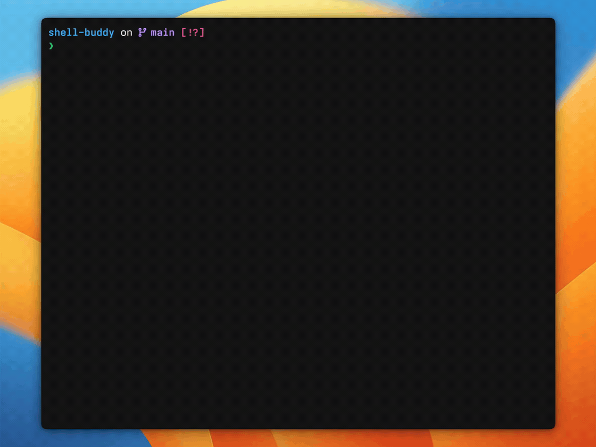

<p align="center">
  <picture>
    <source media="(prefers-color-scheme: dark)" srcset="assets/logo-wordmark-dark.svg">
    
  </picture>
</p>
<p align="center"><strong>从想法，到命令。</strong></p>
<p align="center"><a href="README.md">English</a> · <strong>简体中文</strong></p>

输入 `//`，描述你想做的事，命令建议就出现在输入下方。确认、接受，然后继续在熟悉的 Shell 中工作。

<p align="center">
  
</p>

- **留在当前 Shell。** 命令由当前会话执行，目录切换、环境变量和 Shell 状态都能保留。
- **模型由你选择。** 支持本地或云端 OpenAI 兼容接口；明确意图规则和已确认命令缓存无需模型也能使用。
- **保持轻量。** 使用 Zig 0.17.0 构建，只有一个可执行文件，无需守护进程或外部运行时。

## 开始使用

**macOS / Linux 一行安装最新版**，程序和字体一起安装：

```sh
curl -fsSL https://raw.githubusercontent.com/zhanbodev/shell-buddy/main/install.sh | sh
export PATH="$HOME/.local/bin:$PATH"
```

脚本会自动识别系统和架构，并校验下载包的 SHA-256，无需安装 Zig。

支持 **Zsh 5.8+**、**Bash 5+**，以及配合 PSReadLine 2.3.6+ 的 **PowerShell 7.4+**。macOS 自带的 Bash 3.2 不受支持，默认 Zsh 可直接使用。

下载 **[v0.2.0](https://github.com/zhanbodev/shell-buddy/releases/tag/v0.2.0)**，支持 macOS（Apple Silicon / Intel）、Linux x86_64 和 Windows x86_64，发布包包含程序、吉祥物字体和安装器。[预编译包安装 →](docs/install.zh-CN.md#从公开发布包安装)

在当前会话启用 Shell Buddy：

| Shell | 初始化命令 |
| --- | --- |
| Zsh | `eval "$(shell-buddy init zsh)"` |
| Bash | `eval "$(shell-buddy init bash)"` |
| PowerShell | `shell-buddy init powershell \| Out-String \| Invoke-Expression` |

然后配置接口地址、模型、隐藏输入的 API key 和输入样式：

```sh
shell-buddy init
```

向导不下载文件。不配置模型时，也能使用创建文件、创建目录、列出目录和显示当前路径等明确意图规则。

需要持久启用时，把初始化命令写入 Shell 启动文件，并使用二进制的绝对路径。安装器不会修改启动文件或终端设置。[安装与平台支持 →](docs/install.zh-CN.md)

## 随手输入，确认执行

只有行首的 `//` 会触发 Shell Buddy。描述在上，命令建议在下，均按分屏宽度自动换行。

| 按键 | 行为 |
| --- | --- |
| Tab | 显示另一个建议，提示符短暂明暗变化 |
| Enter | 将完整命令放回命令行，供确认或继续编辑 |
| 再按 Enter | 交给当前 Shell 执行 |
| macOS Cmd+Enter / Windows、Linux Ctrl+Enter | 接受并执行，需[配置终端按键](examples/terminal-keys.md) |
| Esc | 退出 AI 模式；有描述时保留描述，描述为空时清空 `//` |
| Ctrl+C | 清空输入，退出 AI 模式 |

未完成的流式结果和隐藏的旧建议都不能被接受。Tab 换版失败时，会恢复已有完整建议并显示简短原因。

## AI 输入

输入 `//` 后，Shell Buddy 临时接管当前输入行，统一显示金色 `❯` 和低对比度底色；空输入提示 `What do you need?`，输入后自动消失。生成与 Tab 换版只改变提示符亮度；完整命令就绪后显示确认提示。接受或取消后恢复用户原有提示符，上方的多行主题信息保持不变。

默认 `"input_style": "square"`，无需额外字体。使用 **Shell Buddy Icons 1.1+** 并配置终端字体后，可在 `shell-buddy init` 选择 `rounded`，或设置 `"input_style": "rounded"` 后运行 `restart`。旧 `icon`、`nerd_font` 设置不再显示额外图标。[圆角字体配置 →](fonts/README.zh-CN.md)

新版输入样式已包含在 v0.2.0 中；上方录屏展示的是 v0.1.0 的旧图标界面。

## 模型由你选择

支持 OpenAI 兼容的流式 Chat Completions 接口，包括 Ollama 的 `/v1`。本地和云端由你主动切换：

```sh
shell-buddy llm local
shell-buddy llm cloud
shell-buddy doctor
```

默认配置目录为 `~/.config/shell-buddy/`。向导保存的密钥单独放在 `credentials.json`，以明文存储并设置私有访问权限；也支持环境变量。[配置与凭据 →](docs/guide.zh-CN.md#模型配置)

| 命令 | 用途 |
| --- | --- |
| `shell-buddy init` | 配置模型、凭据和输入样式 |
| `shell-buddy start` / `stop` | 启用建议，或停用并取消正在生成的请求 |
| `shell-buddy restart` | 校验并重新加载配置，然后启用建议 |
| `shell-buddy status` | 查看状态与配置路径 |
| `shell-buddy cache-clear` | 清空已确认命令缓存 |

无需后台服务。使用同一配置目录的终端共享状态变更。

## 轻量，不打扰

Shell Buddy 依次检查已确认命令缓存、明确意图规则，再调用所选模型。每次 AI 编辑会话启动一个进程，使用标准库实现 HTTP/TLS 和流式处理，支持取消请求与丢弃过期响应。只缓存用户接受过的命令，最多 256 条。

性能目标：二进制 **≤5 MiB**，编辑器峰值 RSS **≤20 MiB**，本地建议 p95 **≤30 ms**。这些是目标值，模型与网络耗时单独测量。[性能数据与平台验收状态 →](docs/reference.md#performance)

## 开发

从当前源码构建安装，需要 **Zig 0.17.0**：

```sh
zig build -Doptimize=small
sh scripts/install-local.sh
export PATH="$HOME/.local/bin:$PATH"
```

Windows：

```powershell
zig build -Doptimize=small
pwsh -File .\scripts\install-local.ps1
$env:PATH = "$env:LOCALAPPDATA\Programs\ShellBuddy\bin;$env:PATH"
```

运行检查：

```sh
zig build -Doptimize=small
zig build test
python3 tests/integration.py
python3 tests/benchmark.py
python3 tests/release.py
```

产物位于 `zig-out/bin/`。集成测试使用本地模拟服务和伪终端，不使用真实凭据。Windows 原生 PowerShell 测试位于 `tests/windows_terminal.py`；[CI](.github/workflows/ci.yml) 定义各平台检查。

[中文指南](docs/guide.zh-CN.md) · [安装](docs/install.zh-CN.md) · [品牌与吉祥物](docs/brand/README.md) · [English](README.md)
