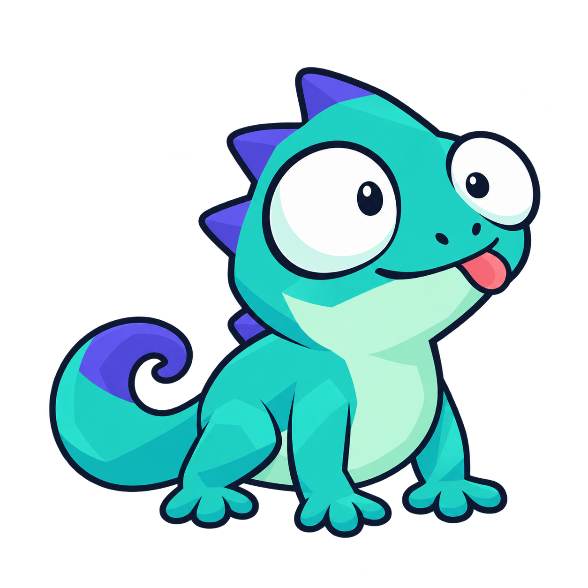
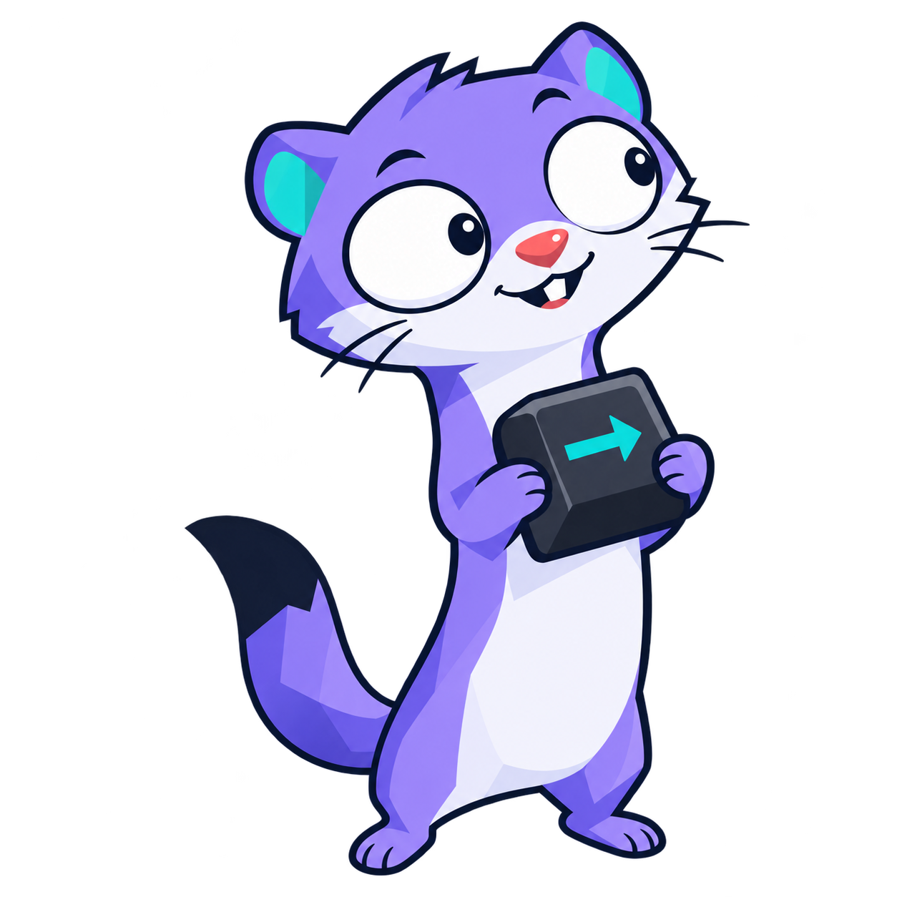
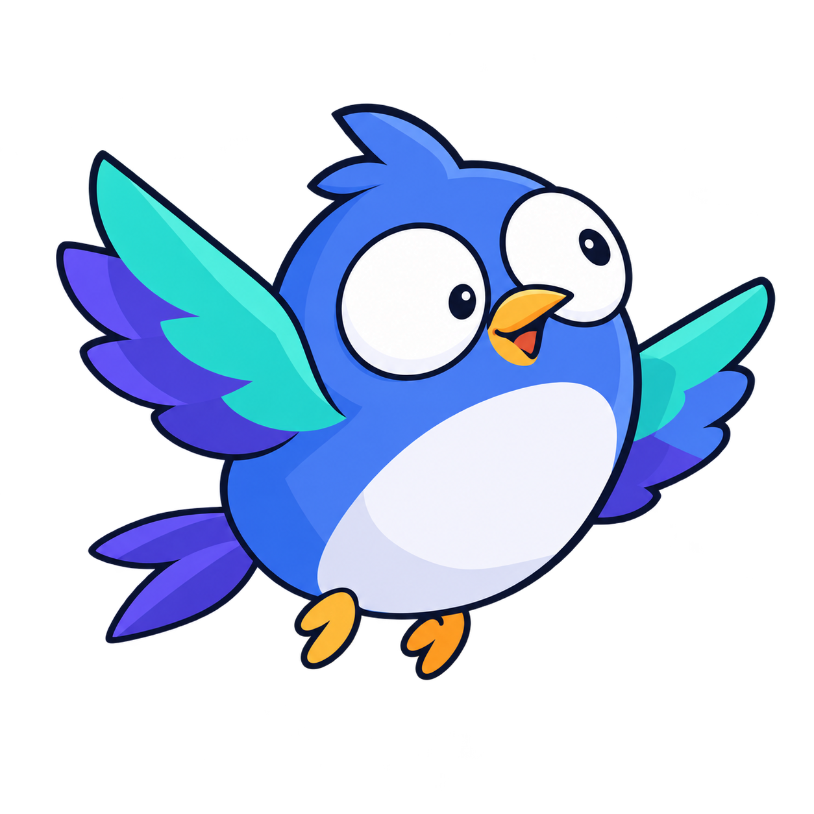
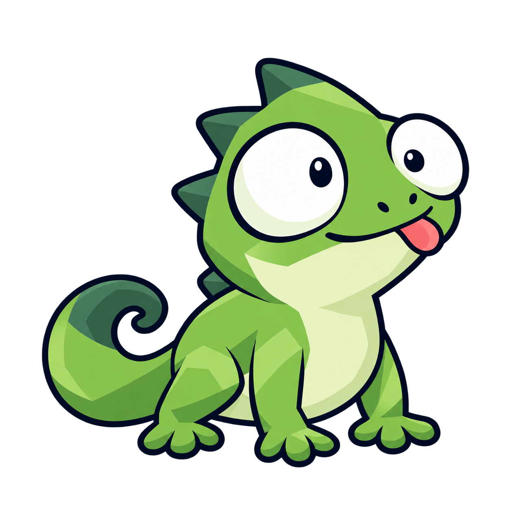
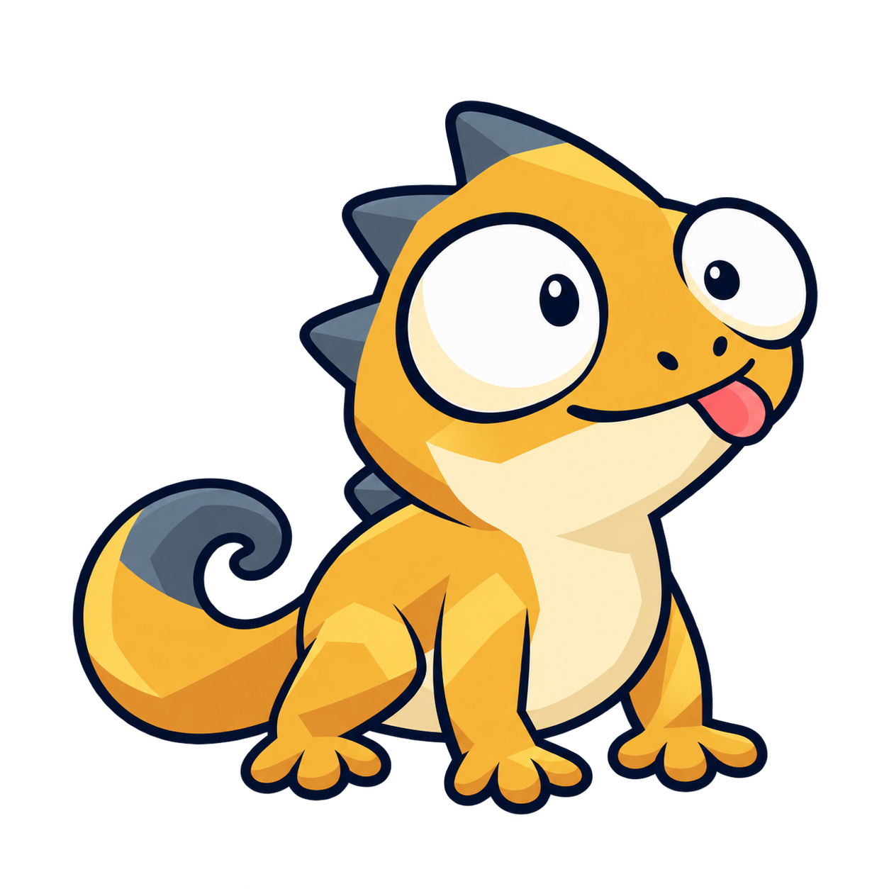
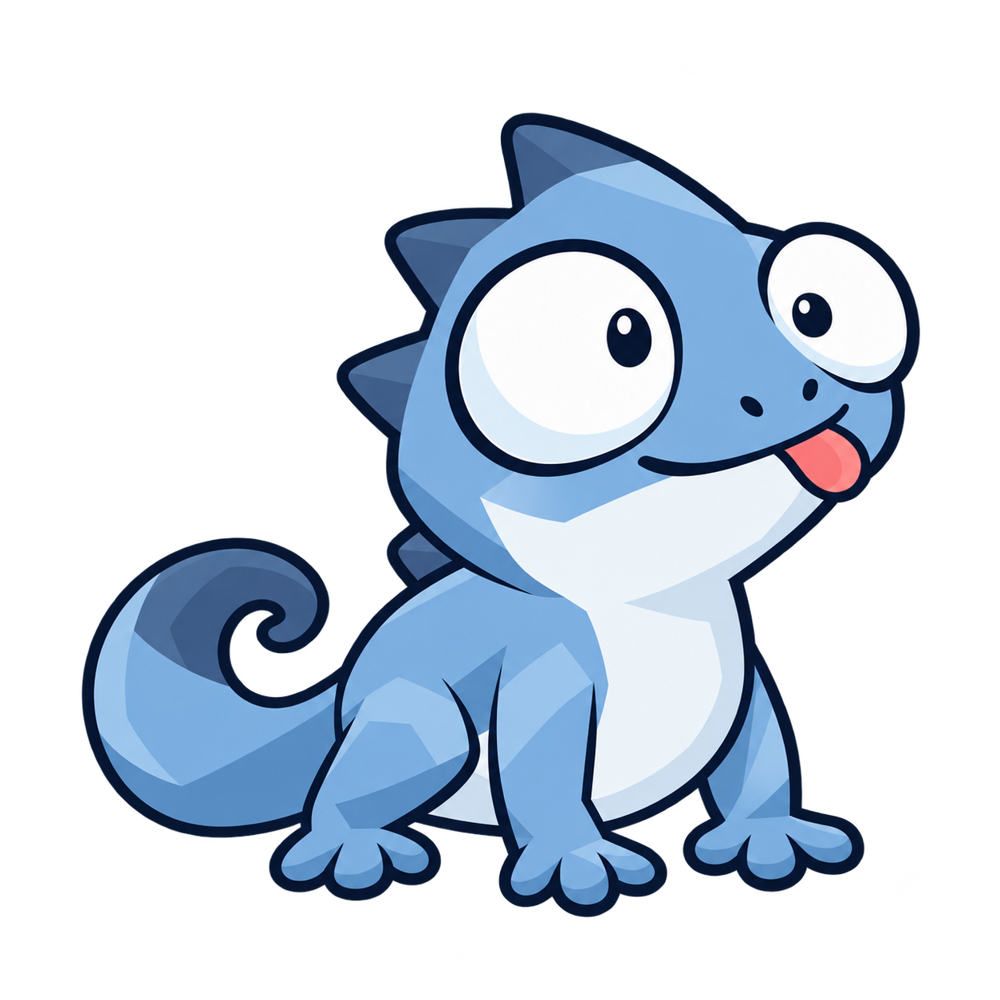

# Shell Buddy brand

[English README](../../README.md) · [中文首页](../../README.zh-CN.md)

The current direction is a colorful, lovable, slightly ridiculous developer companion: lively eyes, a recognizable silhouette, and enough personality to become a sticker. 

The selected identity is the tongue-out ziguana in **mango gold and graphite**. The vector master is [assets/logo.svg](../../assets/logo.svg). Both READMEs select [light](../../assets/logo-wordmark-light.svg) or [dark](../../assets/logo-wordmark-dark.svg) logo + wordmark through a theme-aware picture element. The [PNG](../../assets/logo.png) remains available. The animal and palette are confirmed; the original concepts remain below as exploration history.

| Ziguana · 鬣蜥 | Stoat · 白鼬 | Swift · 雨燕 |
| :---: | :---: | :---: |
|  |  |  |
| Big eyes, tiny tongue, curled tail | Curious eyes, one tooth, one oversized key | Round body, tiny feet, excited wings |
| Closest to the requested playful Zig connection | Strongest keyboard companion story | Clearest speed and lightness metaphor |

## Colorways · 配色

The selected ziguana keeps its silhouette, eyes, tongue, pose, and facet shading. Three transparent colorways are available:

| Apple green · 苹果绿 | Mango gold · 芒果黄 | Mist blue · 雾蓝 |
| :---: | :---: | :---: |
|  |  |  |
| Fresh and natural | Playful, with a Zig color connection | Soft and calm |

**已选定：芒果黄＋石墨灰。** 身体为芒果黄，肚皮为浅奶黄，背刺和尾尖为冷石墨灰，舌头保留珊瑚红。苹果绿与雾蓝保留为配色探索稿；三案均为实际透明背景。

## Direction

The [Zun logo](https://github.com/zhanbodev/zun-lang/blob/dev/assets/logo-wordmark-light.svg) informed the multicolor regions, clear eye highlight, and compact animal identity. The Go gopher informed the requested awkward, cute character tone. These are references for expression and craft; no existing mascot image or path is embedded in the new concepts.

The ziguana direction connects to the animal family of Zig's mascots, with a fresh drawing. Zig's [official logo repository](https://github.com/ziglang/logo) identifies Zero and Ziggy as Ziguana mascots. Direct adaptations of those drawings must retain their required credits; this exploration did not import those source assets.

新版采用多色色块、大眼睛、轻微不对称和夸张表情，强调“陪你敲命令的小伙伴”。推荐先推进吐舌鬣蜥：轮廓紧凑、表情容易记住，能延展成眨眼、思考、庆祝、报错等状态。白鼬适合键盘搭档的故事，雨燕更突出快速轻巧。

## Identity system

- **Name:** Shell Buddy; CLI identifier: `shell-buddy`.
- **Main accent:** mango gold `#F2B640`, with `#D88C2F` shadow facets and `#F8D06A` highlights.
- **Supporting colors:** graphite `#465361`, pale yellow `#FFF0C7`, and coral tongue `#F17173`. These are design targets; raster antialiasing and shading add intermediate tones.
- **Text:** deep ink `#172236` on light backgrounds; pale gray on dark backgrounds.
- **Typography:** a contemporary, confident sans serif for the name; monospace for commands. README titles use the host's typography for consistent rendering.
- **Shape:** rounded, compact anatomy with crisp geometric color facets. Eyes and pose carry the humor; no accessory clutter.
- **Terminal:** default `icon: "star"` displays `✦`; explicit `icon: "lizard"` uses our own [monochrome font](../../fonts/README.md) at U+F5000. Font installation and terminal configuration precede opt-in. The glyph retains the approved mascot's silhouette and facial cutouts; the full-color artwork remains outside the executable.

The mascot can be colorful while the surrounding README remains quiet: one centered mark, a clear name, one line of positioning, one accurate terminal example, and language navigation. No decorative category strips, badge walls, or inflated feature claims.

## README structure

`README.md` is the English entry point. `README.zh-CN.md` mirrors its structure in Simplified Chinese. Both link to one another at the top.

The reading order is mascot/name → a terminal example → build and shell setup → keyboard behavior → model choice → architecture and performance targets → development. Detailed behavior belongs in [English reference](../reference.md) and [中文指南](../guide.zh-CN.md), keeping both homepages short and usable.

When behavior changes, update the English and Chinese homepages together, then the reference documents. Keep paths relative to each file so both GitHub and local repository previews resolve the assets.

## Assets and next refinement

The three `assets/brand/*-v2.png` files are transparent PNG concepts generated with the built-in image generation tool. Exact prompts and reference roles are recorded in [prompts.json](prompts.json); recolor instructions are in [color-prompts.json](color-prompts.json). The rejected monochrome direction is not used by the README.

The animal and palette are selected. `assets/logo.svg` is a transparent SVG traced from the approved PNG, with 403 editable vector paths and a scalable viewBox. The two wordmark SVGs combine the same paths with outlined **Avenir Next Bold** lettering, so viewers do not need that font installed. Light uses ink `#172236`; dark uses pale text `#F1F5F9`. All three SVG files are self-contained, without raster images or external font dependencies.

The SVG conversion approximates the PNG's softly shaded pixels with color regions; the source PNG remains available for comparison. The full-body drawing is intended for brand presentation. A tiny application icon may need a separately simplified face.
